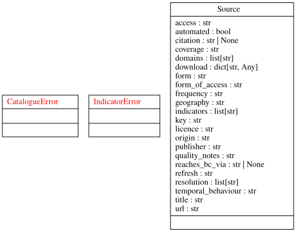
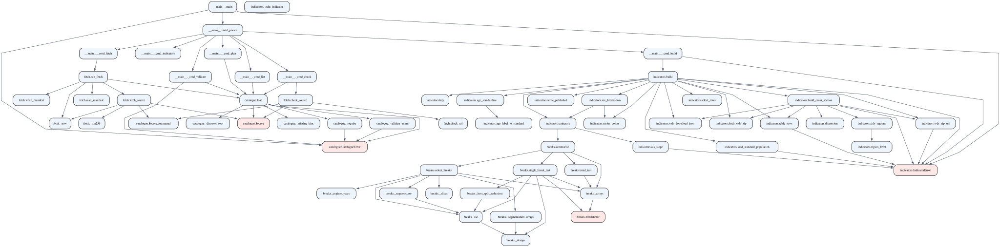

## Repository layout

```
state-of-health-bc/
├── README.md              Project overview (start here on GitHub)
├── ROADMAP.md             Milestones, deliverables, acceptance criteria
├── LICENSE                GPL-3.0
├── pyproject.toml         Python package metadata for the sohbc tooling
├── _quarto.yml            Documentation site configuration
├── index.qmd              Site landing page
├── references.bib         Bibliography: sources cited in the docs
├── src/sohbc/             Acquisition and indicator tooling (Python)
├── scripts/               Maintenance scripts (diagram generation)
├── tests/                 Tests for the sohbc tooling
├── data/
│   ├── catalogue/         Data-source catalogue (sources.yml) — committed
│   ├── published/         Tidy indicator datasets — committed
│   ├── raw/               Fetched data — gitignored, reproducible
│   └── manifest.json      Fetch manifest with checksums — gitignored
├── tutorials/             Learning-oriented: guided lessons
├── how-to/                Task-oriented: task recipes
├── reference/             Information-oriented: lookup pages
├── explanation/           Understanding-oriented: concepts & context
└── .github/workflows/     CI: tests, site render, gh-pages deploy
```

The analysis code and data pipeline grow with the milestones: the
acquisition tooling (`src/sohbc/`) and the data-source catalogue land in
M2; descriptive analysis (M3), dependence (M4), and causal work (M5)
follow.

## Diagrams

Two generated views of the `sohbc` package live in `reference/diagrams/`.
Regenerate them with:

```bash
uv run python scripts/make_diagrams.py
```

(Requires [Graphviz](https://graphviz.org). The documentation workflow
regenerates them on every deploy, so the published diagrams always match
the source.)

### UML class diagram



### Static call graph

Derived statically from the source: nodes are functions, methods, and
classes (classes shaded red); edges are uses — calls and references such
as exception handling.



### Dynamic call graph

Derived dynamically at run time: an offline exercise of the CLI
(`validate`, `list`, `plan`, `indicators`, `build`) is traced under
`cProfile` and rendered with [gprof2dot](https://github.com/jrfonseca/gprof2dot).
Nodes are the functions actually executed, annotated with call counts
and time; edges are calls observed during the run. This is a development
tool only — its output is gitignored, since it depends on the code path
exercised and the machine it ran on:

```bash
uv run python scripts/make_dynamic_callgraph.py
```

## Running the data pipeline

The `sohbc` tooling is a small Python package. After `uv sync`, run it
through the project environment:

```bash
uv run sohbc validate   # check the catalogue schema
uv run sohbc list       # list catalogued sources
uv run sohbc check --all  # verify source URLs
uv run sohbc fetch --all  # fetch automated sources
uv run sohbc indicators   # list defined indicators
uv run sohbc build        # build published indicator datasets
```

Fetched data lands in `data/raw/` (gitignored) with a checksum recorded
in `data/manifest.json`, so a clean checkout reproduces the dataset from
the committed catalogue; tidy indicator datasets are published (and
committed) under `data/published/`. See
[How to ingest a data source](../how-to/ingest-data.qmd).

Run the tooling's tests with:

```bash
uv run python -m unittest discover -s tests -v
```

## The four Diátaxis sections

Each directory maps to one mode of the
[Diátaxis](https://diataxis.fr) framework [@procidadiataxis]:

| Directory | Mode | Character |
|-----------|------|-----------|
| `tutorials/` | Learning | Lessons for newcomers, run start to finish |
| `how-to/` | Task | Recipes for a specific job, assume prior knowledge |
| `reference/` | Information | Neutral, accurate, structured for lookup |
| `explanation/` | Understanding | Discussion that contextualises and deepens |

When adding a page, pick the section first, then write for that mode.
A single topic can justify a page in more than one section — e.g. a
recipe ("how to ingest a source") and its background ("how the ingestion
pipeline works") are different pages, not one blended page.

## Site configuration

`_quarto.yml` controls the site:

- `project.render` — the exact list of files rendered into the site
  (README and LICENSE are deliberately excluded).
- `website.navbar` — navigation; add new pages there so they are
  reachable.
- `format.html.theme` — light (`cosmo`) and dark (`darkly`) themes.

## Deployment

On every push to `main`, `.github/workflows/docs.yml` runs `quarto render`
and publishes the built site from `_site/` to the `gh-pages` branch.
GitHub Pages serves that branch at
<https://galenseilis.github.io/state-of-health-bc>.
